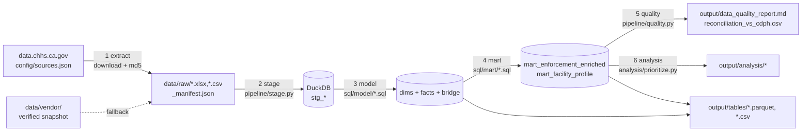
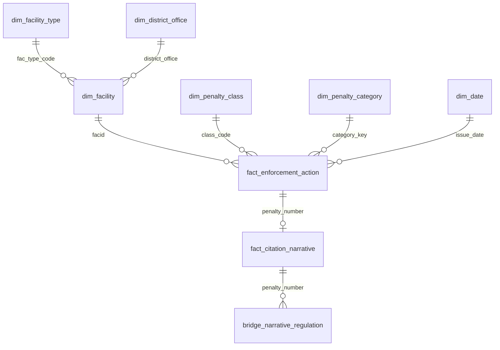
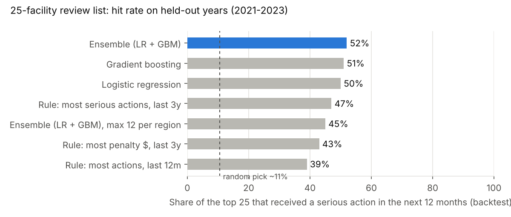

# California Health-Facility Enforcement: Pipeline, Model & Prioritization

A reproducible pipeline over CDPH's **Health Facilities State Enforcement Actions** open data (20,550 citations
and penalties, 1998-2024, plus 2,885 LTC citation narratives). It downloads the raw files, builds a validated
star schema in DuckDB, joins it into an enriched mart, and uses that mart to answer the client question:

> **"We can only review 25 facilities next quarter. Which should we prioritize, and why?"**

Answer: [`output/analysis/top25_priority_facilities.csv`](output/analysis/top25_priority_facilities.csv) (summary at the bottom).

---

## Quickstart

```bash
git clone <this repo> && cd ca-enforcement
make all          # = pip install -r requirements.txt && python run_pipeline.py
```

| Command | What it does |
|---|---|
| `make all` | Full run. Downloads every resource from data.chhs.ca.gov, verifies md5 against the publisher's manifest, builds everything (~20 s). |
| `make offline` | Same pipeline from the committed snapshot in `data/vendor/` (identical md5s) - for air-gapped / firewalled runs. |
| `python run_pipeline.py --skip-analysis` | Stop after the mart and the quality checks. |
| `make clean` | Delete `data/raw`, `data/warehouse`, `output`. |

Requires Python 3.10+. If the portal is unreachable, the extract stage falls back to `data/vendor/` automatically and
records that in `data/raw/_manifest.json`, so a run never silently uses unverified data.

## Architecture overview



| Stage | Code | Lands in |
|---|---|---|
| 1 Extract | `pipeline/extract.py` | `data/raw/` + `_manifest.json` (origin, md5, size per file) |
| 2 Stage | `pipeline/stage.py` | `stg_*` tables in `data/warehouse/enforcement.duckdb` |
| 3 Model | `sql/model/*.sql` (run in order) | dims, facts, bridge in DuckDB + `output/tables/` |
| 4 Mart | `sql/mart/*.sql` | `mart_*` in DuckDB + `output/tables/` |
| 5 Quality | `pipeline/quality.py` | `output/data_quality_report.md`, `output/reconciliation_vs_cdph.csv`. **Any `error` check stops the run.** |
| 6 Analysis | `analysis/prioritize.py` | `output/analysis/` (backtest, scores, top 25, chart) |

DuckDB was chosen because the whole warehouse is one file, the SQL is portable to Snowflake/BigQuery/dbt with
minimal change, and it reads/writes Parquet natively. Every modeled table is exported to Parquet (typed) and CSV
(spreadsheet-friendly; the narrative table is Parquet only).

### Relational model



| Table | Grain | Rows | Built from |
|---|---|---:|---|
| `fact_enforcement_action` | one citation / penalty (`penalty_number`) | 20,550 | main data file |
| `fact_citation_narrative` | one LTC citation narrative (1:0..1 with the fact) | 2,885 | narratives CSV |
| `bridge_narrative_regulation` | narrative x cited regulation (F-tag / Title 22 §) | 2,219 | regex over narrative text |
| `dim_facility` | `facid` | 2,710 | lifted out of the fact (see FD check) |
| `dim_facility_type` | ELMS facility-type code | 48 | lookup `FAC_TYPE_CODE` + `FAC_FDR` blocks |
| `dim_district_office` | district office as named in the data | 21 | lookup `District_Office` block + crosswalk |
| `dim_penalty_class` | initial class code (AA, A, B, AP IJ, ...) | 14 | lookup class blocks + business rules |
| `dim_penalty_category` | violation category | 57 | lookup `penalty_category` block, fuzzy-matched |
| `dim_date` | day, with CA state fiscal year | 11,150 | generated spine |
| **`mart_enforcement_enriched`** | one row per action, all dims joined | 20,550 | fact + 6 dims + narrative + bridge |
| `mart_facility_profile` | one row per facility, history summary | 2,710 | aggregated mart |

## Relationships discovered and how they were validated

Nothing below is asserted by the publisher as a key; each was found by profiling and is re-tested on every run
(`pipeline/quality.py`, results in `output/data_quality_report.md`).

| Finding | Evidence | Consequence |
|---|---|---|
| `PENALTY_NUMBER` is the fact's primary key | 20,550 distinct of 20,550, all 9 digits | fact grain |
| `FACID` functionally determines name, LTC flag, type, FDR roll-up, district | 0 of 2,710 FACIDs have >1 value for any of them | facility attributes moved to `dim_facility` |
| `PENALTY_DETAIL` <-> `CLASS_ASSESSED_INITIAL` is exactly 1:1 | crosstab is diagonal | class code is the key, detail text is an attribute |
| Narratives join to facts on `PENALTY_NUMBER` | 2,882 / 2,885 match (99.9%); FACID agrees on 100% of matches; class agrees 99.9%; covers 99.2% of eligible LTC AA/A/B citations 2012-17 | 1:0..1 extension table |
| The lookup "table" is **five tables stacked in one sheet**, each with its own header row and its own meaning for the DESCRIPTION/VALUE columns | header rows repeat at rows 42 and 64; values swap columns between blocks | split into five staging tables |
| District names in the data differ from the lookup (`Orange` vs `Orange County`; one `San Diego` vs North/South; numbered `LA Region 1-3` and program units vs named LA offices; `Stockton` missing) | 12 of 21 match exactly | explicit, documented crosswalk `config/district_crosswalk.csv` with a `match_type` per row; test fails if a new office appears |
| Adverse-event categories are coded `AE17 - ...` in data but `AE: ...` in the lookup, with spelling drift | 17 exact, 25 normalised, 2 fuzzy, 13 not in lookup | normalise -> Jaro-Winkler >= 0.93. A 0.90 threshold produced a **false match** ("breach by health care worker" -> "by person *other than* a h/c worker"), caught in review |
| `EVENTID = 'A99999'` is a legacy placeholder on 4,944 rows | one value on 24% of rows across unrelated facilities | nulled in staging so it can never create a many-to-many join |
| `CLASS_ASSESSED_FINAL` has trailing tabs and mixed case (`'B\t'`, `'Drop>Deficiency\t'`) | 2,276 rows with tab | normalised; mapped to an interpretable `final_outcome` (Upheld / Downgraded / Dropped / Trebled ...) |
| Amount columns obey a ledger identity | `final + offset - collected - balance = 0` on 100% of rows | tested every run |
| CDPH's published charts use `TOTAL_AMOUNT_DUE_FINAL` | e.g. Class AA SFY16-17 = $912,279.04 exactly | reconciliation table vs the 2019 visuals: 92% of class x year counts within +/-2 actions (differences are later appeals/reclassifications) |
| Join fan-out | mart rows == fact rows == staging rows | every mart join is many-to-one |

## Client question: which 25 facilities to review

**Method.** From the mart, build a facility snapshot every six months (2005-2023). Features use only actions issued
*before* the snapshot (counts, serious counts, recency, dollars, abuse/care/staffing categories, appeals, type).
Label: the facility receives a **serious action** - Class AA (death), Class A (imminent danger) or a hospital
Immediate-Jeopardy AP - in the following 12 months. Train on 2005-2020 snapshots, test on four held-out snapshots
(Jul 2021 - Jan 2023) whose outcomes the model never saw. Score all 1,324 currently active facilities as of
29 Jun 2024 (the day after the data ends).

**Backtest** (average of 4 held-out snapshots; full detail in `output/analysis/backtest_by_snapshot.csv`):

| Method | Hits in top 25 | Precision | vs random |
|---|---:|---:|---:|
| **Ensemble (logistic + gradient boosting)** | **13.0** | **52%** | **5.0x** |
| Rule: most serious actions, last 3 years | 11.75 | 47% | 4.5x |
| Ensemble, max 12 per region | 11.25 | 45% | 4.3x |
| Rule: most penalty dollars, last 3 years | 10.75 | 43% | 4.1x |
| Rule: most actions, last 12 months | 9.75 | 39% | 3.7x |
| Random 25 | ~2.6 | ~11% | 1.0x |



**Recommendation.** Review the 25 facilities in `top25_priority_facilities.csv`. The model expects about 12 of them
to receive a serious citation in the next year, versus about 3 for a random 25. All 25 are skilled nursing
facilities and 23 are in Los Angeles. Each row includes plain-language reasons, and four carry a statutory flag:
a Class AA in the last 24 months, so a second AA would trigger mandatory license suspension/revocation proceedings
(HSC 1424.5(a)(1)). Those four are the highest-consequence reviews.

The LA concentration is real in the facilities' own histories (LA facilities receive serious actions at 2-5x the
rate of other regions every year, and removing region as a feature barely changed the list). It may partly reflect
district enforcement intensity, which this data alone cannot separate. If review capacity is split across district
offices, use `top25_region_capped.csv` (max 12 per region): in the backtest it gave up about 1.75 hits per list.

## Decision note

**Tradeoffs and assumptions**
- *DuckDB + SQL files over dbt/Airflow.* One command, one file, no services; the SQL ports directly to dbt models.
  With a team or a schedule, dbt (tests become `schema.yml`) plus an orchestrator is the next step.
- *Vendored snapshot.* The source page is archived, so committing the md5-verified files makes the run reproducible
  even if the portal disappears. The download path is still the default.
- *Crosswalk as a seed file, not a heuristic.* District names don't match the lookup well enough to fuzzy-join safely;
  a 21-row CSV with an explicit `match_type` is auditable. LA numbered regions resolve only to "Los Angeles".
- *Label = issue date of a serious action.* Median lag from violation to citation is ~5 months, so some "future"
  citations are already under investigation at scoring time. For a review-prioritisation use that is acceptable
  (the review can accelerate them) but it is not a pure prediction of new harm.
- *Severity ranking* (AA > A = IJ > WMF/WMO > B ...) follows the class definitions in CDPH's background paper.
- *Universe.* Only facilities with at least one action are visible; "active" means an action in the last 5 years.
  Never-cited facilities and facility closures are invisible in this dataset.

**With more time**
1. Join the CHHS **Healthcare Facility Bed Types and Counts** and **Facility Services** files on `FACID` (the
   dictionary names them as linkable) to normalise by beds and separate risk from size and district intensity.
2. Add federal CMS inspection/deficiency data for SNFs (more frequent signal than state citations).
3. Text-to-metrics on the narratives: the F-tag / Title 22 bridge is built; next is clustering themes and testing
   whether narrative themes add lift (coverage is only LTC 2012-17, so it was not used in the model).
4. Calibrate probabilities and track the list's realised hit-rate each quarter as a monitoring metric.
5. Move the regional cap into an optimisation with real reviewer capacity per district.

## Agentic tool usage

Built with Claude (Anthropic) as a pair-programmer in an agentic session that could run code. How it was used:
- **Profiling first.** Claude ran exploratory queries that surfaced the stacked lookup sheet, the `A99999`
  placeholder, the tab-padded final classes, and the 1:1 detail/class relationship before any model was written.
- **Writing the pipeline** (Python stages, SQL models, tests) and iterating on errors as they ran.
- **Human-style review of its own output.** Inspecting `dim_penalty_category` row by row caught a wrong fuzzy match,
  which led to raising the threshold and documenting why. Inspecting the first top-25 (all LA) led to the region
  analysis, dropping the region feature, and the capped alternative. A 7-minute feature build was profiled and
  vectorised to 8 seconds.
- **Reconciliation against the publisher's own charts** was used as an independent check rather than trusting
  the tool's code.

Judgement calls (label definition, crosswalk mappings, severity order, how to present the LA concentration)
were made explicitly and are written down above so they can be challenged.

## Repository layout

```
config/            sources.json (URLs + md5 from publisher manifest), district_crosswalk.csv
data/vendor/       md5-verified snapshot of the raw files (offline fallback)
docs/reference/    CDPH background paper and published charts used for reconciliation
pipeline/          extract, stage, transform (SQL runner/exporter), quality
sql/model/         dimension, fact, bridge SQL
sql/mart/          enriched mart SQL
analysis/          prioritize.py (client question)
output/tables/     modeled tables + marts (Parquet + CSV)
output/analysis/   backtest, scores, top-25 lists, chart
run_pipeline.py    single entry point; Makefile wraps it
```

Source: California Department of Public Health, Center for Health Care Quality, via the CHHS Open Data Portal
(dataset `healthcare-facility-state-enforcement-actions`, archived).
